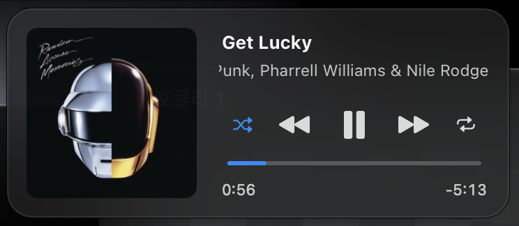

# NowPlayingBar


A macOS menu bar widget that shows the **currently playing track**, with a glass
control card on click. Pick which sources to show (Apple Music, Safari, Spotify, …);
long titles **scroll slowly to the left (marquee)** to reveal the whole thing.




## Features

- **Menu bar title** for the active player, with a marquee for long titles.
- **Source filter** — show only the apps you choose; apps you play from are added
  to the list automatically.
- **Display options** — artist, album, hide when paused, widget width (presets or
  any value from 80 to 600 pt), scroll speed.
- **Control card** (left-click the widget) — artwork, title, artist and album,
  play / pause, previous / next, and a scrubber you can click or drag to seek.
  Click the artwork to open the source app.
- **Shuffle & repeat buttons** (optional) — toggle commands sent to the playing
  app; for Apple Music the card also shows the current mode.

## Requirements

- macOS 13 or later (developed on macOS 26 "Tahoe").
- The **Command Line Tools** (clang + Swift). No Xcode, no Homebrew.

## Build & run

```sh
git clone https://github.com/TmTmTmTmTmT/NowPlayingBar.git
cd NowPlayingBar
chmod +x build-app.sh
./build-app.sh
open build/NowPlayingBar.app
```

To see logs in the terminal while running:

```sh
./build/NowPlayingBar.app/Contents/MacOS/NowPlayingBar
```

The app lives only in the menu bar (no Dock icon). Nothing is shown until a
track from an enabled source is playing.

## Usage

- **Left-click** the widget — open or close the control card.
- **Right-click** (or Control-click) the widget — open the options menu:
  - **Sources** — `Show all sources`, then a checkbox per app. Only checked
    sources appear in the menu bar.
  - **Display**
    - `Show artist` — append `— Artist` to the title.
    - `Show album` — append `— Album` to the title (after the artist, if shown).
    - `Hide when paused` — only show while actually playing.
    - `Width` — titles wider than this scroll; shorter ones sit still. Narrow 120 ·
      Medium 176 · Wide 240 · Extra wide 320 pt, or `Custom…` (80–600 pt).
    - `Scroll speed` — Slow / Medium / Fast.
    - `Show shuffle & repeat` — add shuffle and repeat buttons to the control card
      (the card widens from 320 to 360 pt). Each button sends a toggle command to
      the playing app. For Apple Music the card also shows the current mode: blue
      means on, and the `repeat.1` icon means repeat one. Other sources show no mode.
  - **Quit** (⌘Q)

## Permissions

Reading Apple Music's shuffle and repeat state uses AppleScript, so macOS asks for
**Automation** permission for Music the first time you open the card with
`Show shuffle & repeat` on. If you decline, the buttons still send their toggle
commands but no mode is shown. The permission is only requested when that option is
enabled.

If the prompt was denied or reset (for example after a rebuild, since the app is
ad-hoc signed), re-enable it in System Settings ▸ Privacy & Security ▸ Automation,
or run:

```sh
tccutil reset AppleEvents com.local.nowplayingbar
```

## Why it needs a helper

Since **macOS 15.4** (and through **macOS 26 "Tahoe"**), Apple's `mediaremoted`
daemon rejects the private `MediaRemote.framework` calls when they come from an
ordinary third-party app — there is **no public API** for system-wide Now Playing.

The only working approach is [**ungive/mediaremote-adapter**](https://github.com/ungive/mediaremote-adapter)
(BSD 3-Clause): it loads a small helper framework inside Apple's own
`/usr/bin/perl` (code-signing identity `com.apple.perl`), which still passes the
daemon's entitlement check. No SIP changes, no system modification — the helper
runs as a separate process and prints JSON.

This project **vendors** that adapter under `vendor/mediaremote-adapter/` and
compiles it at build time. The compiled framework lives only inside the app
bundle.

## How source filtering works

Each update carries two ids: `bundleIdentifier` (the publishing process) and
`parentApplicationBundleIdentifier` (the owning app). Media played in **Safari**
is published by a WebKit subprocess, so the widget filters on the **parent**
id (`com.apple.Safari`) when present — otherwise Safari tracks would never match.

## Project layout

```
Package.swift                      SwiftPM executable
Resources/Info.plist               app Info.plist (LSUIElement = menu-bar only)
build-app.sh                       clang + swift -> signed .app
docs/                              README screenshots
Sources/NowPlayingBar/
  main.swift                       entry point, resource resolution
  NowPlayingInfo.swift             models + JSON / AppleScript output parsers
  NowPlayingMonitor.swift          spawns the perl adapter, streams updates, sends commands
  Preferences.swift                source whitelist + options (UserDefaults)
  MarqueeView.swift                Core Animation marquee
  StatusContentView.swift          status item content (marquee + sizing)
  NowPlayingPopoverController.swift  control card: artwork, buttons, scrubber
  AppDelegate.swift                status item, menu, card panel, wiring
vendor/mediaremote-adapter/        bundled BSD-3 helper (compiled at build time)
```

## Caveats

- Relies on a **private** framework via the `com.apple.perl` trick. Apple could
  close this in a future macOS update (they tightened it once, in 15.4). If that
  happens, the widget simply stays hidden.
- Not sandboxed and not App-Store-eligible (private framework). Built for
  personal use with ad-hoc signing.
- Shuffle / repeat mode display is Apple Music only; other apps do not report
  these modes to the system.

## License

MIT for this project — see [LICENSE](LICENSE). `vendor/mediaremote-adapter/` is
BSD 3-Clause; see its own [LICENSE](vendor/mediaremote-adapter/LICENSE).

## Credits

- [ungive/mediaremote-adapter](https://github.com/ungive/mediaremote-adapter) — the Now Playing bridge (BSD 3-Clause).
- Marquee technique inspired by [Jaysce/Jukebox](https://github.com/Jaysce/Jukebox).
