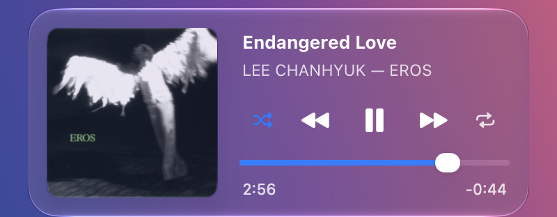

# NowPlayingBar


**지금 재생 중인 곡**을 보여 주는 macOS 메뉴 막대 위젯입니다. 위젯을 클릭하면 Liquid Glass
컨트롤 카드가 열립니다. 표시할 재생 앱(Apple Music, Safari, Spotify 등)을 고를 수 있고,
긴 제목은 **왼쪽으로 천천히 흐르며(마퀴)** 전체를 보여 줍니다.




## 기능

- **메뉴 막대 제목** — 재생 중인 앱의 곡 제목을 표시하고, 긴 제목은 마퀴로 흐릅니다. 일시정지하면 흐리게 표시됩니다.
- **재생 앱 필터** — 선택한 앱만 표시하고, 새로 재생한 앱은 목록에 자동으로 추가됩니다.
- **표시 옵션** — 아티스트, 앨범, 일시정지 시 숨기기, 위젯 너비(프리셋 또는 80~600pt 직접 입력), 스크롤 속도.
- **컨트롤 카드** (위젯 왼쪽 클릭) — 앨범 커버, 제목·아티스트·앨범, 재생/일시정지, 이전/다음, 클릭·드래그로 이동하는 재생 막대. 커버를 클릭하면 재생 앱이 열립니다.
- **버튼 하이라이트** — 버튼에 포인터를 올리면 원형 강조가 나타나고, 누르면 더 진해지며 살짝 커집니다. HDR을 지원하는 화면(다크 모드)에서는 누르는 순간 일반 흰색보다 밝게 빛납니다.
- **셔플·반복 버튼** (옵션) — 재생 앱에 토글 명령을 보냅니다. Apple Music은 현재 상태(켜짐은 파란색, 한 곡 반복은 `repeat.1` 아이콘)도 표시합니다.
- **플로팅 가사** (Apple Music 전용) — Apple Music 가사 화면처럼 **단어 단위로 차오르는** 가사를 별도 Liquid Glass 창에 보여 줍니다. 아래 [가사](#가사) 참고.
- **Liquid Glass 선택** — 카드를 Regular(기본) 또는 Clear로 바꿉니다. Clear는 더 투명한 유리에 뒤 화면 블러를 더하고, 버튼과 제목은 또렷하게, 앨범 커버는 85% 투명도로 보여 줍니다(끄면 100%).

## 가사

Apple Music에서 재생 중인 곡의 가사를 **음절(단어) 단위 타이밍**에 맞춰 보여 줍니다. Apple Music 앱이
이미 받아 둔 가사를 읽기만 하며, 가사를 저장하거나 전송하지 않습니다. 다른 재생 앱(Safari, Spotify 등)이
재생 중일 때는 가사 창이 자동으로 사라집니다.

- **단어별 채움** — 지금 부르는 음절이 왼쪽에서 오른쪽으로 차오르고, 지난 줄·다음 줄은 흐리게 보입니다. 간주에는 점 세 개가 호흡하듯 움직입니다.
- **파도·글로우 강조** — 한 어절은 하나로 묶여 채움 진행에 맞춰 살짝 떠오르며 빛납니다. 길게 끄는 단어(0.8초 이상)는 단어 전체가 시작부터 끝까지 천천히 함께 떠오르고, 파도·글로우·밝기가 단어가 끝나는 순간 함께 최대가 됩니다. 다음 줄은 시작 0.3초 전에 부드럽게 가운데로 올라옵니다. 코러스가 앞 줄과 겹쳐도 앞 줄은 마지막 글자까지 채워집니다.
- **배경 보컬·번역** — 배경 보컬은 작게 아래에 표시하고, 번역이 있으면 `Show translation` 으로 보여 줍니다.
- **위치** — 화면 어디든 옮길 수 있는 **Floating**, 컨트롤 카드 아래에 붙는 **Below card**, 메뉴 막대 바로 아래 **Below menu bar** 중에서 고릅니다. Floating은 마지막 위치를 기억하며, 화면 아래쪽에서 재생목록 탭을 열어도 화면 안으로 밀려 올라왔다가 가사 탭으로 돌아오면 원래 자리로 돌아갑니다.
- **재생목록 탭** — Floating·Below card에서 Apple Music의 현재 재생목록을 보여 주고, 곡을 누르면 재생합니다. 셔플이 켜져 있어도 **플레이리스트 순서**대로 표시됩니다(실제 셔플 순서는 공개 방법이 없어 보여 줄 수 없습니다).
- **일시정지** — 일시정지 후 설정한 시간(5·10·15·20·30초·1분)이 지나면 가사 창이 사라집니다. 가사를 스크롤하는 동안에는 사라지지 않습니다.

### 가사를 읽는 방법

Music 앱은 가사 화면을 열면 `~/Library/Caches/com.apple.Music` 의 URL 캐시에 곡별 가사(TTML)를 저장합니다.
NowPlayingBar는 이 캐시를 **읽기 전용**으로 열어 재생 중인 곡을 제목·길이·재생 시작 시각으로 찾습니다.
제목이 다른 언어로 오는 곡도 재생 시작 시각과 길이로 찾습니다.

- **Music을 실행한 뒤 가사 화면을 한 번 열어야** 이후 곡부터 자동으로 가사가 저장됩니다. 그 전에는 "Apple Music에서 가사를 한 번 열어 주세요" 안내가 보이며, 가사 화면을 여는 즉시 곡을 넘기지 않아도 가사가 나타납니다.
- 캐시에 가사가 없는 곡(가사 미제공 곡 포함)은 "가사를 찾지 못했습니다"로 표시됩니다.
- 이 캐시 형식은 비공개이므로 Music 업데이트로 바뀌면 가사가 나오지 않을 수 있습니다.

### HDR 가사 강조

HDR을 지원하는 화면에서는 가사의 **밝은(채워진) 글자가 일반 흰색보다 더 밝게** 빛납니다. 글자가 떠오르는
동안 점점 밝아지고, 그 뒤에는 기본 밝기로 가라앉습니다.

- **조건** — 어두운 모양(다크 모드 또는 Liquid Glass 고정 다크)과 HDR(EDR) 화면이 모두 필요합니다. 조건이 안 맞으면 일반 밝기로 표시됩니다. 화면이 낼 수 있는 최대 밝기를 넘지 않도록 자동으로 제한합니다.
- **세기** — 유리 종류에 따라 세 단계로 자동 조절합니다. Regular는 가장 약하게, Clear(블러 켬)는 조금 더 강하게, Clear에서 블러를 끈 순수 투명 유리는 가장 강하게 빛납니다.
- **끄는 법** — 시스템 설정의 손쉬운 사용 ▸ 디스플레이 ▸ **동작 줄이기**를 켜면 파도 움직임을 줄이고 글로우만 간단히 보여 줍니다.

## 요구 사항

- macOS 26 이상 (Liquid Glass 컨트롤 카드).
- Xcode 26 또는 macOS 26 SDK가 있는 Command Line Tools (Swift 5.9 이상). Homebrew는 빌드에 필요하지 않습니다.

## Homebrew로 설치

```sh
brew install TmTmTmTmTmT/tap/nowplayingbar
open "$(brew --prefix)/opt/nowplayingbar/NowPlayingBar.app"
```

Homebrew가 내 Mac에서 소스를 직접 빌드하므로 Command Line Tools(`xcode-select --install`)와
macOS 26 이상이 필요합니다. 응용 프로그램 폴더에 두려면
`cp -R "$(brew --prefix)/opt/nowplayingbar/NowPlayingBar.app" /Applications/` 를 실행하세요.
업데이트는 `brew upgrade nowplayingbar`, 삭제는 `brew uninstall nowplayingbar` 입니다
(설정은 남으며, `defaults delete com.local.nowplayingbar` 로 지울 수 있습니다).

## 직접 빌드해서 실행

```sh
git clone https://github.com/TmTmTmTmTmT/NowPlayingBar.git
cd NowPlayingBar
chmod +x build-app.sh
./build-app.sh
open build/NowPlayingBar.app
```

터미널에서 로그를 보면서 실행하려면:

```sh
./build/NowPlayingBar.app/Contents/MacOS/NowPlayingBar
```

앱은 메뉴 막대에만 있습니다(Dock 아이콘 없음). 허용한 앱에서 곡이 재생되기 전에는 아무것도 표시되지 않습니다.

## 사용법

- **왼쪽 클릭** — 컨트롤 카드를 열거나 닫습니다.
- **오른쪽 클릭**(또는 Control-클릭) — 옵션 메뉴를 엽니다.
  - **Sources** — `Show all sources` 와 앱별 체크박스. 체크한 앱만 메뉴 막대에 표시됩니다.
  - **Display**
    - `Show artist` — 제목 뒤에 `— 아티스트` 를 붙입니다.
    - `Show album` — 제목 뒤에 `— 앨범` 을 붙입니다(아티스트가 켜져 있으면 그 뒤).
    - `Hide when paused` — 실제로 재생 중일 때만 표시합니다. 끄면 일시정지 중에는 제목이 흐리게 보입니다.
    - `Width` — 이 너비보다 긴 제목은 흐르고, 짧으면 멈춰 있습니다. Narrow 120 · Medium 176 · Wide 240 · Extra wide 320 pt, 또는 `Custom…`(80~600pt).
    - `Scroll speed` — Slow / Medium / Fast.
    - `Liquid Glass` — `Regular` / `Clear` 중 선택하고, 아래 두 항목으로 Clear일 때 앨범 커버를 85%로 투명하게 할지, 뒤 화면 블러를 없애 순수한 투명 유리로 할지 정합니다. 선택해도 메뉴가 닫히지 않습니다.
    - `Show shuffle & repeat` — 컨트롤 카드에 셔플·반복 버튼을 추가합니다(카드 너비가 320에서 360pt로 늘어남). 각 버튼은 재생 앱에 토글 명령을 보냅니다. Apple Music은 현재 상태도 표시하며, 파란색은 켜짐, `repeat.1` 아이콘은 한 곡 반복입니다. 다른 앱은 상태를 표시하지 않습니다.
  - **Music Card** — 컨트롤 카드 표시 방식: `On click` · `Always shown` · `Always shown with Lyrics Card`(카드와 가사를 항상 함께 표시).
  - **Lyrics Card** — 가사 창 옵션.
    - `Show lyrics` — 가사 창을 켜고 끕니다.
    - `Hide when paused` — 일시정지 후 가사 창이 사라질 때까지의 시간(5s~1m).
    - `Placement` — Floating / Below card / Below menu bar.
    - `Context`·`Lines` — 현재 줄 주변을 보일지, 보이는 줄 수.
    - `Text size` — S / M / L.
    - `Floating width` — Floating일 때의 너비.
    - `Lock position` — Floating 창 이동을 막습니다(Floating 전용).
    - `Click-through` — 가사 창을 클릭이 통과하게 합니다(Floating·Below menu bar). 켜면 클릭 이동(seek)·스크롤·드래그도 통과합니다.
    - `Blur other lines` — 현재 줄이 아닌 줄을 흐리게 합니다.
    - `Click line to seek` — 줄을 클릭해 그 위치로 이동합니다.
    - `Show translation` — 번역을 보여 줍니다.
  - **Quit** (⌘Q)

## 권한

Apple Music의 셔플·반복 상태는 AppleScript로 읽기 때문에, `Show shuffle & repeat` 를 켠 채
카드를 처음 열면 macOS가 Music에 대한 **자동화(Automation)** 권한을 요청합니다. 거부해도
버튼은 토글 명령을 보내지만 상태는 표시되지 않습니다. 이 옵션을 켰을 때만 권한을 요청합니다.

가사 창의 **재생목록 탭**은 Apple Music의 현재 재생목록을 AppleScript로 읽기 때문에, 탭을 처음 열 때도
같은 자동화 권한을 요청합니다. 거부하면 재생목록 탭만 동작하지 않고 가사는 그대로 보입니다. 가사 자체는
Music의 캐시 파일을 읽으므로 별도 권한이 필요하지 않습니다.

권한을 거부했거나 초기화된 경우(앱이 ad-hoc 서명이라 다시 빌드하면 초기화될 수 있습니다)
시스템 설정 ▸ 개인정보 보호 및 보안 ▸ 자동화에서 다시 허용하거나, 아래를 실행하세요.

```sh
tccutil reset AppleEvents com.local.nowplayingbar
```

## 별도 도우미가 필요한 이유

**macOS 15.4** 이후(**macOS 26 "Tahoe"** 포함) Apple의 `mediaremoted` 데몬은 일반 서드파티 앱이
호출하는 비공개 `MediaRemote.framework` 요청을 거부합니다. 시스템 전체의 재생 정보를 얻는
**공개 API는 없습니다**.

유일하게 동작하는 방법은 [**ungive/mediaremote-adapter**](https://github.com/ungive/mediaremote-adapter)
(BSD 3-Clause)입니다. Apple 자체의 `/usr/bin/perl`(코드 서명 ID `com.apple.perl`) 안에서 작은
도우미 프레임워크를 불러와, 데몬의 권한 검사를 통과합니다. SIP 변경이나 시스템 수정은 필요 없고,
도우미는 별도 프로세스로 실행되어 JSON을 출력합니다.

이 프로젝트는 해당 어댑터를 `vendor/mediaremote-adapter/` 에 **포함(vendoring)** 하고 빌드할 때
컴파일합니다. 컴파일된 프레임워크는 앱 번들 안에만 있습니다.

## 재생 앱 필터링 방식

업데이트마다 `bundleIdentifier`(재생을 게시한 프로세스)와
`parentApplicationBundleIdentifier`(소유 앱) 두 ID가 함께 옵니다. **Safari** 에서 재생되는 미디어는
WebKit 하위 프로세스가 게시하므로, 위젯은 부모 ID(`com.apple.Safari`)가 있으면 그것으로 필터링합니다.
그렇지 않으면 Safari 곡이 목록과 맞지 않게 됩니다.

## 프로젝트 구조

```
Package.swift                      SwiftPM 실행 파일
Resources/Info.plist               앱 Info.plist (LSUIElement = 메뉴 막대 전용)
build-app.sh                       clang + swift -> 서명된 .app
docs/                              README 스크린샷
Sources/FloatingLyric/             가사·재생목록 라이브러리 (앱 코드를 모름)
  Source/                          Music 캐시 가사 읽기, TTML 파서, 재생목록(AppleScript)
  Sync/                            재생 시계, 가사 표시 규칙
  UI/                              가사 뷰, 파도·글로우·HDR 강조, Liquid Glass 패널, 재생목록 뷰
Tests/FloatingLyricTests/          가사·강조·배치 단위 테스트 (Swift Testing)
Sources/NowPlayingBar/
  main.swift                       진입점, 리소스 경로 결정
  NowPlayingInfo.swift             모델 + JSON / AppleScript 출력 파서
  NowPlayingMonitor.swift          perl 어댑터 실행, 업데이트 스트림, 명령 전송
  Preferences.swift                재생 앱 허용 목록 + 옵션 (UserDefaults)
  MarqueeView.swift                Core Animation 마퀴
  StatusContentView.swift          상태 항목 내용 (마퀴 + 크기 계산)
  NowPlayingPopoverController.swift  컨트롤 카드: 커버, 버튼, 재생 막대
  HighlightButton.swift            hover·누름 하이라이트 버튼
  KeepOpenMenu.swift               선택해도 닫히지 않는 메뉴 행
  AppDelegate.swift                상태 항목, 메뉴, 카드 패널, 연결
vendor/mediaremote-adapter/        포함된 BSD-3 도우미 (빌드 때 컴파일)
```

## 주의 사항

- `com.apple.perl` 방식으로 **비공개** 프레임워크에 의존합니다. Apple이 이후 macOS 업데이트에서 막을 수 있습니다(15.4에서 한 번 강화됨). 그렇게 되면 위젯은 표시되지 않은 채로 있습니다.
- 샌드박스를 쓰지 않고 App Store 배포도 불가능합니다(비공개 프레임워크). 개인 사용을 목적으로 ad-hoc 서명으로 빌드합니다.
- 가사는 Apple Music이 로컬 캐시에 저장한 것만 읽습니다(비공개 형식). Music에서 가사 화면을 한 번 열기 전에는 가사가 없을 수 있고, 캐시가 정리된 곡은 다시 열어야 합니다.
- 가사 창의 일부 효과(항상 활성처럼 보이는 유리 테두리)는 AppKit의 **비공개** 메서드에 의존합니다. 없어지면 효과만 사라지고 기능은 그대로입니다.
- 가사는 화면에 표시만 하며 디스크에 저장하거나 외부로 보내지 않습니다.
- 셔플·반복 상태 표시는 Apple Music에서만 동작합니다. 다른 앱은 이 상태를 시스템에 알리지 않습니다.

## 라이선스

이 프로젝트는 MIT 라이선스입니다 — [LICENSE](LICENSE) 참고. `vendor/mediaremote-adapter/` 는
BSD 3-Clause이며, 자체 [LICENSE](vendor/mediaremote-adapter/LICENSE) 를 따릅니다.

## 크레딧

- [ungive/mediaremote-adapter](https://github.com/ungive/mediaremote-adapter) — Now Playing 연동 (BSD 3-Clause).
- 마퀴 기법은 [Jaysce/Jukebox](https://github.com/Jaysce/Jukebox) 에서 영감을 얻었습니다.
